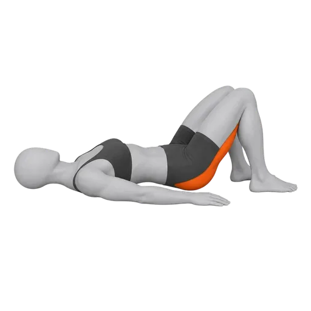

<div align="center">


# Free Exercise Dataset & Database (JSON + images)

<p>
  
  
  
  
  
  
</p>

**708 exercises for fitness apps in one JSON file: 512 px illustrations, target muscles, equipment, MET values and step-by-step instructions in English, German and Spanish. Free to use in apps, paid ones included, as long as you credit RepDB.**

[](exercises.json)
[](#multilingual)
[-success?style=flat-square)](LICENSE-DATA.md)

**[Download the free ZIP](https://cdn.repdb.co/repdb-assets/site/repdb-free.zip)** &nbsp;·&nbsp; **[Browse all 708 exercises](https://exercise-dataset.com/)** &nbsp;·&nbsp; **[Exercise animations](https://repdb.co/exercise-animations/?utm_source=github-readme)**

If it saves you time, a star helps the next developer find it.

</div>

## Exercise animations and GIFs

The free set is still pictures. If your app needs motion, **RepDB Standard** has looping animations for 551 of the 708 exercises. Every clip has a transparent background and the same character, so the animations sit on light, dark or branded screens and the library looks like one product.

<a href="https://repdb.co/exercise-animations/?utm_source=github-readme">
  
  
</a>

These two clips are paid previews: fine for judging quality, not for shipping (license term 6).

**[Animation gallery](https://repdb.co/exercise-animations/?utm_source=github-readme)** &nbsp;·&nbsp; **[Exercise GIFs](https://repdb.co/exercise-gifs/?utm_source=github-readme)** &nbsp;·&nbsp; **[Pricing](https://repdb.co/pricing/?utm_source=github-readme)**

**Standard, $499 once.** Besides the animations you get:

- **Muscle heatmap.** Front and back body layers that your app colours from its own training data: weekly volume, recovery, muscles worked. [Try the demo](https://repdb.co/?utm_source=github-readme#muscle-heatmap)
- **MP4 and GIF copies** of every clip, 512×512 on white, next to the transparent WebP masters.
- **1024 px stills** in two styles: classic on a transparent background, and flat.
- **SQLite** next to the JSON, plus a relations graph, workout templates and AI embeddings.
- **French** on top of English, German and Spanish, and no attribution requirement.
- An optional **female character** (+$99) with a female version of every exercise.

**Only need pictures?** Stills, $299 once: the classic and flat stills at 1024 px with the JSON in four languages, no animations.

Need an exercise we don't have yet, or animations in your own style? We take [custom work](https://repdb.co/custom/?utm_source=github-readme).

---

## What's in the free set

This repository is the free public edition of [RepDB](https://repdb.co/?utm_source=github-readme), an exercise library for fitness apps. It contains:

- **708 exercises**, one record each in [`exercises.json`](exercises.json)
- **1,231 flat illustrations**, 512×512 WebP: a start and a peak pose, or one pose for stretches and holds
- target and secondary muscles, equipment, body part, category, difficulty, mechanic and force type
- a **MET value** per exercise for calorie estimates
- names, descriptions, instructions and form tips in **English, German and Spanish**
- 29 muscle icons and 64 equipment icons

All of it is original work made for RepDB, not scraped from other sites. And it is files, not an API: no key, no rate limit, no monthly bill. Copy it into your app and it keeps working.

> [!IMPORTANT]
> **Attribution is required.** Put a visible link, **"Exercise data by RepDB (repdb.co)"**, on your app's about or credits screen, in your project's README, or in your website footer. That is the price of the free tier. The link may be `rel="nofollow"`.

Copy-paste versions in Markdown, HTML and as app credits are in [`ATTRIBUTION.md`](ATTRIBUTION.md).

## License (summary)

Full text: [`LICENSE-DATA.md`](LICENSE-DATA.md). The seven terms in short:

1. **Free for personal and commercial use inside applications**: apps, websites, research projects, at no cost.
2. **Attribution required**: a visible "Exercise data by RepDB (repdb.co)" link (`rel="nofollow"` is fine).
3. **No redistribution as a dataset**: don't republish, resell or repackage it (or a derivative) as a dataset, dataset repo or API. In-app use only.
4. **Image modifications**: resizing, cropping and recolouring for in-app use is fine; upscaled or background-removed derivatives still fall under the no-redistribution rule.
5. **No generative-AI derivation**: the images may not be used as input, reference, or training or conditioning material for generative models (image-to-image restyling, style transfer, fine-tuning and the like); outputs count as derived datasets.
6. **`premium-samples/` is evaluation-only**: the paid-tier samples in that folder may not be used in production or redistributed.
7. **No warranty; not medical advice.**

This repository is RepDB's own canonical free-tier distribution. Term 3 restricts third parties, not this publication (see "About this repository" in the license). The `index.html` viewer code is [MIT](LICENSE-CODE).

## Quickstart

```js
const data = await fetch(
  "https://exercise-dataset.com/exercises.json"
).then(r => r.json());

console.log(data.count, "exercises");
const ex = data.exercises[0];
console.log(ex.name_en, "·", ex.name_de, "·", ex.name_es);
console.log(ex.images.flat.start ?? ex.images.flat.main);   // "images/flat/<id>-start.webp"
```

```python
import json, urllib.request
url = "https://exercise-dataset.com/exercises.json"
data = json.load(urllib.request.urlopen(url))
print(data["count"], "exercises")
for ex in data["exercises"]:
    print(ex["id"], "→", ex["body_part"], ex.get("equipment", "bodyweight"))
```

For production, ship `exercises.json` and the images with your app instead of fetching them from exercise-dataset.com on every start.

## Exercise GIFs from the free images

A simple exercise GIF is two poses with a crossfade between them. 523 of the 708 exercises here have both poses, start and peak, at 512 px, so you can make one in a few lines of Python with Pillow. Run it from the repository root:

```python
from PIL import Image

def crossfade_gif(start_path, peak_path, out_path, steps=5, hold=1000, step=100):
    a = Image.open(start_path).convert("RGB")
    b = Image.open(peak_path).convert("RGB")
    blends = [Image.blend(a, b, i / (steps + 1)) for i in range(1, steps + 1)]
    frames = [a, *blends, b, *reversed(blends)]
    durations = [hold, *[step] * steps, hold, *[step] * steps]
    frames[0].save(out_path, save_all=True, append_images=frames[1:],
                   duration=durations, loop=0)

crossfade_gif("images/flat/squat-start.webp",
              "images/flat/squat-peak.webp", "squat.gif")
```

That gives a 512×512 GIF: the start held for a second, a short fade, the peak held for a second, and back. Holds and stretches have a single pose, so there is nothing to fade. It is still a crossfade, not real movement; real movement is what the [Standard animations](https://repdb.co/exercise-animations/?utm_source=github-readme) are for.

Use the GIFs in your app the same way as the images. A folder of them is still the dataset, so the no-redistribution rule applies (license term 3).

## Schema

`exercises.json` is a single object: `{ name, homepage, license, schema_version, count, note, exercises[] }`.

Each entry in `exercises[]`:

| Field | Type | Notes |
|---|---|---|
| `id` | string | URL-safe slug, e.g. `bulgarian-split-squat` |
| `name_en` / `name_de` / `name_es` | string | Display name per locale |
| `description_en` / `_de` / `_es` | string | Short summary |
| `instructions_en` / `_de` / `_es` | string[] | Step by step |
| `tips_en` / `_de` / `_es` | string[] | Form cues |
| `category` | string | `strength`, `stretching`, `cardio`, `olympic`, `plyometrics` |
| `force_type` | string | `push` / `pull` / `static` / `dynamic` |
| `mechanic` | string | `compound` / `isolation` |
| `difficulty` | string | `beginner` / `intermediate` / `advanced` |
| `equipment` | string | e.g. `dumbbell`, `kettlebell`, `cable`; absent for bodyweight-only moves |
| `body_part` | string | Primary region |
| `primary_muscles` / `secondary_muscles` | string[] | Anatomical slugs; `secondary_muscles` can be absent |
| `goals` | string[] | e.g. `hypertrophy`, `strength` |
| `tags` | string[] | e.g. `knee_safe`, `no_axial_load`; can be absent |
| `variation_group` | string | Shared by variants of one movement; absent when an exercise has none |
| `met` | number | Metabolic equivalent, for calorie estimates |
| `is_unilateral` / `is_bodyweight` | bool | |
| `images` | object | `{ flat: {start, peak} }` **or** `{ flat: {main} }`, repo-relative WebP paths |

### Images

- `images/flat/`: flat-style illustrations on a solid background, **512×512 WebP**.
- Most exercises have two poses, `start` and `peak`; stretches and holds have a single `main` pose. **Handle both shapes.**
- A few near-identical variants use the same picture. Key your UI by exercise `id`, not by image path.
- The path is already in each record: `ex.images.flat.peak` → `images/flat/<id>-peak.webp`.

<a name="multilingual"></a>
### Multilingual

Names, descriptions, instructions and tips ship in **English, German and Spanish** for every exercise in this snapshot. French comes with the paid tiers.

## `premium-samples/`: paid-tier preview (evaluation only)

The [`premium-samples/`](premium-samples/) folder holds one **Standard** exercise, classic stills plus a looping animation on a transparent background, so you can judge the paid files before buying. It is **evaluation-only**: not for production, not for redistribution (license term 6). More exercises are in the [animation gallery](https://repdb.co/exercise-animations/?utm_source=github-readme).

## Free vs. Standard

Counts checked **November 14, 2026**: this free snapshot contains **708 exercises**, and so does the paid catalog. Standard animates **551 of them**; the other **157** are static holds and stretches with still illustrations.

| | **Free** (this repo) | [**Standard**](https://repdb.co/pricing/?utm_source=github-readme) |
|---|---|---|
| Exercises | 708 | 708 |
| Still illustrations | flat style · solid background · 512×512 WebP | flat **+ classic** · 1024×1024 WebP, classic on a transparent background |
| Character | — | one consistent character with the target muscles highlighted |
| Animation | — | looping animations for **551 exercises** on transparent backgrounds, plus MP4 and GIF copies on white |
| Muscle heatmap | muscle icons (`images/muscles/`) | front + back body layers to colour from your own data |
| Data | JSON + WebP | JSON **and SQLite**, relations graph, workout templates, AI embeddings |
| Languages | EN · DE · ES | EN · DE · ES · **FR** |
| Female character | — | optional add-on (+$99) |
| License | in-app use, visible RepDB attribution | your own brand, no attribution |
| Price | free | **$499** once · images only: Stills, **$299** once |

**[Standard details and pricing](https://repdb.co/pricing/?utm_source=github-readme)**: one payment, no subscription, no API, no rate limits.

## Example apps

Starter apps that ship this dataset:

- **Next.js**: https://github.com/RepDB/repdb-example-nextjs
- **React Native (Expo)**: https://github.com/RepDB/repdb-example-react-native
- **Flutter**: https://github.com/RepDB/repdb-example-flutter

## FAQ

**Is there a free exercise API?**
You don't need one for this data. `https://exercise-dataset.com/exercises.json` is a static file you can call like an endpoint, with no key and no rate limit. For a real app, copy the JSON and images into your project so nothing depends on our hosting.

**Can I use it in a commercial app?**
Yes. In-app use is free, paid apps included, as long as the "Exercise data by RepDB (repdb.co)" credit is visible. You may not republish the data as your own dataset or API.

**Looking for an ExerciseDB alternative?**
RepDB works differently from a hosted API: you get files and keep them, so there is no subscription, no rate limit and no service to go offline. Start with the free set here; Standard adds animations, GIFs and MP4s.

**Do you have exercise GIFs or videos?**
The free set has the two poses a simple GIF needs, and [the snippet above](#exercise-gifs-from-the-free-images) fades them into one. Real motion is in Standard: every animated exercise comes as a transparent WebP loop plus 512×512 MP4 and GIF copies on white. See the [exercise GIFs page](https://repdb.co/exercise-gifs/?utm_source=github-readme).

**How often is it updated?**
The free set follows every RepDB release; each one is a dated [GitHub release](https://github.com/RepDB/exercise-dataset/releases) here. What changed, release by release: [repdb.co/updates](https://repdb.co/updates/?utm_source=github-readme).

## Links

- RepDB: [repdb.co](https://repdb.co/?utm_source=github-readme)
- Browse this dataset: https://exercise-dataset.com/
- One page per exercise with muscles worked, equipment, instructions, tips and the raw JSON record, e.g. https://exercise-dataset.com/exercise/bulgarian-split-squat/
- Questions: support@repdb.co
